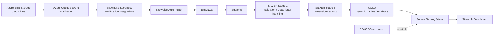

# FlowBridge — Snowflake Supply Chain Data Platform

A cloud data engineering and analytics project demonstrating an Azure-to-Snowflake ingestion path, layered data processing, operational stream handling, governed analytical serving, and a Streamlit dashboard.

> **Execution status — author-confirmed (8 November 2026):** The project owner has rerun the latest repository version in their Snowflake environment and confirmed that the end-to-end project works correctly. The repository does not currently retain sanitized runtime logs, query IDs, or dashboard screenshots, so this is recorded as owner confirmation rather than as independently inspectable execution evidence. This portfolio project is not a claim of production operation or measured business impact.

## Business problem

Supply-chain stakeholders need a consolidated view of order, shipment, supplier, and inventory information. FlowBridge uses JSON order data arriving through Azure storage and moves it into Snowflake for validation, dimensional modelling, aggregation, and governed analytics.

## Solution architecture



See [the architecture documentation](docs/ARCHITECTURE.md) for the business scenario and technical diagrams, and [the operations guide](docs/OPERATIONS.md) for deployment sequencing and environment safeguards. The diagrams explain the platform conceptually; the numbered SQL scripts remain the source of truth for object definitions and dependencies.

## Original business-context illustrations

The following original visuals were supplied by the project author. They explain the business setting and the manual-reporting problem that motivated the scenario. They are **business-context illustrations**, not service-topology diagrams, measured business results, or deployment evidence. The technical platform flow remains documented in the Mermaid architecture above and in [the architecture guide](docs/ARCHITECTURE.md).


## Engineering capabilities

- **Automated ingestion pattern:** Azure storage integration, event notification, and Snowpipe file auto-ingest.
- **Layered data architecture:** Bronze landing, Silver validation and dimensional modelling, and Gold analytical structures.
- **Incremental processing:** Snowflake Streams, stored procedures, and scheduled Tasks.
- **Data quality:** Required-field and payload validation, malformed-record handling, and dead-letter routing.
- **Deterministic processing:** Explicit source selection and merge behavior to reduce ambiguous updates.
- **Dimensional modelling:** Customer, product, supplier, warehouse, and shipment dimensions with an order-grain fact table.
- **Analytics:** Gold dynamic tables and secure serving views.
- **Governance:** Role-based access grants and a governed serving contract for dashboard consumers.
- **Environment strategy:** Separate DEV and PROD database objects with an explicit production bootstrap script.
- **Application layer:** Streamlit dashboard querying the Snowflake serving view.

## Data flow

1. JSON files are delivered to Azure Blob Storage.
2. Azure event/queue notifications connect storage events to Snowflake ingestion configuration.
3. Snowpipe loads incoming records into the Bronze layer.
4. Stream-driven Silver stage 1 processing validates and standardizes payloads; rejected records are routed to a dead-letter table.
5. Silver stage 2 processing builds dimensions and the fact table.
6. Gold dynamic tables expose analytical aggregates.
7. Secure serving views provide curated outputs to the dashboard under governed roles.

## Repository structure

| Path | Responsibility |
|---|---|
| `01_account_setup.sql` | Databases, schemas, warehouses, and account-level resources |
| `02_bronze.sql` | Azure integrations, file format, stage, Bronze table, and Snowpipe setup |
| `03_silver_stage1.sql` | Bronze-to-Silver validation, staging, dead-letter handling, and task |
| `04_silver_stage2.sql` | Dimensions, fact table, stream, procedure, and task |
| `05_gold.sql` | Gold dynamic tables and analytical aggregates |
| `06_serving.sql` | Secure serving views |
| `07_governance.sql` | Consumer role and access grants |
| `08_dev_prod.sql` | Fresh-environment DEV-to-PROD bootstrap and production object setup |
| `flowbridge_dashboard/` | Streamlit application and Snowflake app dependency configuration |
| `tests/` | Repository contract and Python syntax checks |
| `docs/` | Architecture, operations, and validation documentation |
| `.github/workflows/validation.yml` | Automated repository-level validation |

## Modelling decisions and metric interpretation

- The current fact grain is **one order with one product item**. Multi-item order payloads are rejected by validation rather than silently represented as one order line.
- The dashboard's inventory movement ratio is an explicitly named **proxy metric**. It is not conventional inventory turnover calculated from cost of goods sold.
- Timestamp-based incremental watermarks depend on source timestamps and are not equivalent to source-system change data capture (CDC).
- Example/demo data is used; analytical results are not representative of a real logistics operation.

## Setup and deployment

Deployment requires appropriately configured Azure and Snowflake accounts, privileges, and integration values. Never commit credentials, account identifiers, tenant IDs, or personal email addresses.

1. Review the numbered SQL scripts and the [operations guide](docs/OPERATIONS.md).
2. Replace documented configuration placeholders with values from your own environment.
3. Configure Azure storage, event notification, and Snowflake integration permissions.
4. Execute `01_account_setup.sql` and `02_bronze.sql` in the intended development environment.
5. Deploy `03_silver_stage1.sql`, `04_silver_stage2.sql`, `05_gold.sql`, `06_serving.sql`, and `07_governance.sql` in dependency order.
6. Validate the DEV pipeline and serving outputs before any production deployment.
7. Use `08_dev_prod.sql` only for its documented fresh-PROD bootstrap scenario. It is not an in-place migration for an already populated production database.
8. Configure the Streamlit application with the intended Snowflake connection and verify dashboard access using the consumer role.

Exact commands and object dependencies are environment-specific; follow the SQL comments and your account's security policies.

## Streamlit application

The dashboard reads from `FLOWBRIDGE_PROD_DB.SERVING_SCH.VW_SUPPLY_CHAIN_OVERVIEW`. It provides date, order-status, and customer-region filters, headline KPIs, and order, fulfillment, supplier, inventory, and shipment views. Use a configured Snowflake connection rather than embedding credentials in source code.

## Validation

The project owner has confirmed that the latest version was rerun successfully in Snowflake. For reproducibility, the repository also includes lightweight local checks:

```bash
python -m compileall -q flowbridge_dashboard
python -m pip install pytest
python -m pytest -q
```

The GitHub Actions workflow runs Python compilation and repository contract tests. These checks are deliberately separate from live Snowflake validation: they do not execute Azure notifications, Snowpipe, SQL procedures, Tasks, dynamic-table refreshes, role grants, or live dashboard queries. See [the validation guide](docs/VALIDATION.md) for the evidence boundary and verification checklist.

## Security

- Keep secrets in Snowflake/Azure secret-management facilities or supported connection configuration.
- Use least-privilege roles and avoid granting broad access to raw or curated data unnecessarily.
- Treat placeholders as configuration instructions, not deployable credentials.
- Review account-level resource controls and role grants before applying scripts.

## Limitations and next engineering improvements

- The project uses illustrative supply-chain data and is not a production logistics system.
- The inventory movement metric is a proxy, not a conventional COGS-based inventory-turnover KPI.
- The current fact design enforces single-item order payloads; supporting multi-line orders requires an explicit order-line grain and corresponding transformation changes.
- Timestamp watermarks are not a substitute for source CDC when reliable change events or source versioning are required.
- Sanitized execution artifacts are not currently committed. A future evidence pack could retain non-sensitive run timestamps, query IDs, object status snapshots, and dashboard screenshots.
- Further hardening could add SQL-aware static analysis and automated tests against an isolated Snowflake test database.

## Technologies

Azure Blob Storage · Azure Queue/Event Notifications · Snowflake · Snowpipe · Streams · Tasks · Stored Procedures · Dynamic Tables · SQL · RBAC · Streamlit · Python

## Author

**Isaiah Nyakundi** — Data Engineer | Cloud Engineer | Analytics Engineer

- GitHub: https://github.com/viradidi