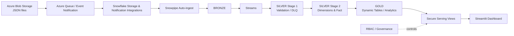

# FlowBridge — Snowflake Supply Chain Data Platform

A cloud data engineering and analytics project that demonstrates an Azure-to-Snowflake ingestion path, layered data processing, operational stream handling, governed analytics serving, and a Streamlit application.

> **Execution status:** The project has been run successfully in the author's Snowflake environment, as confirmed by the author. The repository's latest SQL edits should still be validated with a fresh deployment before treating those edits as newly verified. This repository is an engineering portfolio project; it is not a claim of production operation or measured business impact.

## Business problem

Supply-chain stakeholders need a consolidated view of order, shipment, and inventory information. The scenario starts with JSON order data arriving through Azure storage and moves it into Snowflake for transformation and analytics. FlowBridge demonstrates how ingestion, data quality, transformation, dimensional modelling, and governed consumption can be organized into a repeatable platform.

## Solution overview

The platform is designed around these stages:

The diagram is a conceptual overview; consult the SQL deployment scripts for exact object names and dependencies.

## Engineering capabilities

- **Automated ingestion:** Azure storage integrations and Snowpipe file auto-ingest pattern.
- **Layered data architecture:** Bronze landing, Silver validation and modelling, Gold analytical structures.
- **Incremental processing:** Snowflake Streams and task/procedure processing patterns.
- **Data quality:** Required-field and payload validation, malformed-record handling, and dead-letter routing.
- **Deterministic processing:** Explicit source selection and merge behavior to reduce ambiguous updates.
- **Dimensional modelling:** Supply-chain dimensions and a fact table with documented order-level grain.
- **Analytics:** Gold dynamic tables and secure serving views for consumption.
- **Governance:** Role-based access grants and secure serving layer.
- **Environment strategy:** DEV/PROD deployment scripts and environment-aware configuration.
- **Application:** Streamlit dashboard querying the Snowflake serving view.

## Data flow

1. JSON files are delivered to Azure Blob Storage.
2. Azure event/queue notifications connect storage events to Snowflake ingestion configuration.
3. Snowpipe loads incoming records into Bronze.
4. Stream-driven Silver processing validates and standardizes source payloads; invalid records are routed to a dead-letter path.
5. Silver modelling creates dimensional and fact structures.
6. Gold dynamic tables produce analytical aggregates.
7. Secure serving views expose curated outputs to the dashboard under governed roles.

## Repository structure

The deployment is organized in numbered SQL scripts. Review the repository tree for exact paths and object names:

| Script | Responsibility |
|---|---|
| `01_account_setup.sql` | Account-level setup and resource controls |
| `02_bronze.sql` | Storage integrations, file format, stage, table, and pipe setup |
| `03_silver_stage1.sql` | First Silver transformation, validation, and dead-letter handling |
| `04_silver_stage2.sql` | Dimensional modelling and fact processing |
| `05_gold.sql` | Gold analytical objects and dynamic tables |
| `06_serving.sql` | Secure serving views |
| `07_governance.sql` | Roles and access grants |
| `08_dev_prod.sql` | DEV/PROD environment setup and processing |
| `flowbridge_dashboard/streamlit_app.py` | Streamlit application |

## Key modelling notes

- The current fact grain is **one order with one product item**. Multi-item order payloads are rejected by validation rather than silently treated as a single order line.
- The inventory movement ratio is an explicitly named **proxy metric**. It should not be interpreted as conventional inventory turnover calculated from cost of goods sold.
- Timestamp-based incremental watermarks are not equivalent to source-system CDC.
- Example/demo data is used; results are not representative of a real logistics operation.

## Setup and deployment

Deployment requires appropriately configured Azure and Snowflake accounts, permissions, and integration values. Never commit credentials, account identifiers, tenant IDs, or personal email addresses.

1. Review the numbered SQL scripts in dependency order.
2. Replace documented configuration placeholders with values from your own environment.
3. Configure Azure storage, event notification, and Snowflake integration permissions.
4. Execute account setup and Bronze object creation.
5. Deploy Silver, Gold, serving, and governance objects in order.
6. Apply the environment-specific DEV/PROD script only after reviewing its clone and grant behavior.
7. Configure the Streamlit connection using Snowflake's supported connection configuration.
8. Run ingestion and transformation, then validate the serving view and dashboard outputs.

Exact commands and object dependencies are environment-specific; follow the script contents and your account's security policies.

## Streamlit application

The app reads from the Snowflake serving layer (including the supply-chain overview view). Use a configured Snowflake connection rather than embedding credentials in source code. The dashboard is intended as a consumption layer, not as a replacement for platform observability.

## Validation

The repository includes SQL deployment assets and a Streamlit application. A successful run should be confirmed by executing the scripts and validating:

- Ingestion into Bronze.
- Silver validation and dead-letter outcomes.
- Dimension and fact row counts and grain.
- Gold dynamic-table refresh status and output.
- Role access to secure serving views.
- Dashboard query results.

Do not substitute fabricated logs, screenshots, row counts, or performance benchmarks for actual environment evidence.

## Security

- Keep secrets in Snowflake/Azure secret-management or supported connection configuration.
- Use least-privilege roles and avoid granting broad access to raw or curated data unnecessarily.
- Treat placeholder values as configuration instructions, not deployable credentials.
- Review account-level resource monitor and role grants before applying scripts.

## Limitations and future improvements

- The project uses illustrative supply-chain data and is not a production logistics system.
- The inventory movement metric is a proxy, not a conventional COGS-based inventory-turnover KPI.
- The current fact design enforces single-item order payloads; a future multi-line fact model would require an explicit order-line grain.
- Fresh validation of the most recent repository edits is required before claiming current-version deployment verification.
- Retain sanitized deployment/run evidence and add automated SQL contract tests as the project evolves.

## Technologies

Azure Blob Storage · Azure Queue/Event Notifications · Snowflake · Snowpipe · Streams · Tasks · Stored Procedures · Dynamic Tables · SQL · RBAC · Streamlit · Python

## Author

**Isaiah Nyakundi** — Data Engineer | Cloud Engineer | Analytics Engineer

- GitHub: https://github.com/viradidi
