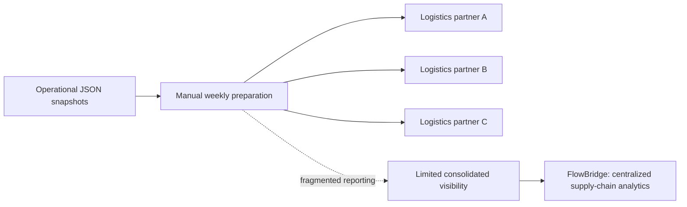
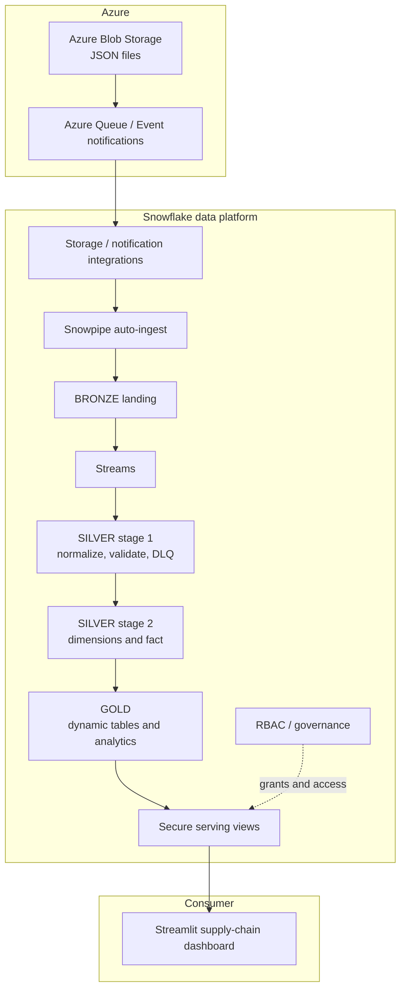

# FlowBridge architecture

This document provides repository-native Mermaid diagrams for the business scenario and technical solution. Use them as readable documentation; they are not screenshots or execution evidence.

## Business scenario

The illustrative business scenario describes weekly JSON snapshots being manually prepared and distributed to three logistics partners. The goal is to consolidate order, shipment, supplier, and inventory information into a governed analytical experience.

## Technical solution

## Data processing stages

| Layer | Responsibility |
|---|---|
| Bronze | Raw ingestion and source landing |
| Silver stage 1 | Validation, standardization, invalid-record routing |
| Silver stage 2 | Dimensional model and order-grain fact processing |
| Gold | Analytics-ready dynamic tables and aggregate outputs |
| Serving | Secure views intended for governed application consumption |

Exact Snowflake object names, configuration values, and dependencies are defined in the numbered SQL deployment scripts.

## Important design constraints

- The current fact design expects one product item per order payload. Multi-item payloads are rejected; supporting them requires a separate order-line fact grain.
- The inventory movement ratio is a proxy metric and is not a conventional COGS-based inventory-turnover calculation.
- The diagrams explain the intended architecture; they are not screenshots or execution evidence. The project owner confirmed that the latest repository version was rerun successfully in their Snowflake environment on 8 November 2026. See the validation guide for the evidence boundary.
